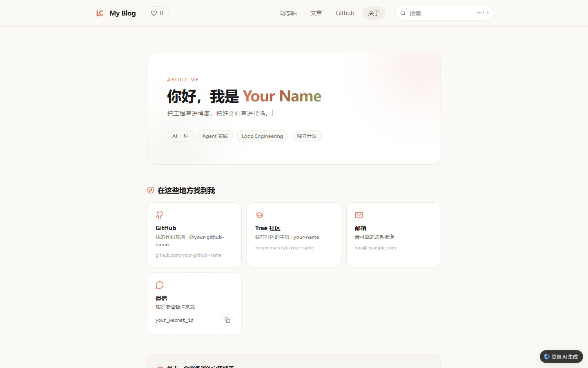
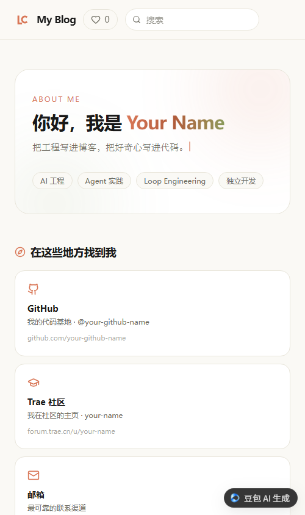

# knowledge-blog

**中文** | [English](#english)

一个开箱即用的个人知识博客模板：React 前台 + NestJS 后台 + PostgreSQL，支持 Markdown / HTML 双渲染、分类与搜索、动态时间轴、GitHub 项目页，还带一个用管理 Token 保护的「文章上传」接口，方便用自己的工具或 AI 直接发布文章。

## 项目简介

- 前台：React 19 + TypeScript + Vite + Tailwind CSS，shadcn/ui 风格组件，衬线正文与陶橙色系的阅读版式。
- 后台：NestJS + Drizzle ORM，文章读写、点赞统计、图片上传。
- 运行形态：整套服务部署在[妙搭（Miaoda）](https://miaoda.feishu.cn)全栈应用里，数据库与对象存储由平台提供。
- 页面：首页文章列表、文章详情、动态时间轴、GitHub 项目页、关于页。

如果你也想做一个「自己的知识博客」，可以直接把这份代码接到你自己的妙搭应用上，再改几处个人信息即可。

## 预览



移动端（实际截图宽度 500px，Chrome 无头模式无法设置更窄的视口）：



## 功能

**前台**

- 首页文章列表：分类筛选（分类可在 `client/src/lib/categories.ts` 里增删）、关键词搜索（`Ctrl/Cmd + K` 聚焦搜索框）。
- 文章详情：Markdown 用 Streamdown 渲染（支持 KaTeX 公式、shiki 代码高亮）；HTML 文章放进沙箱 iframe 原样展示，并注入了 `localStorage` 垫片与锚点跳转兼容。
- 文章目录：右侧（移动端为顶部）大纲，点击平滑滚动到对应小节。
- 动态轴 `/timeline`：按日期倒序分组，日期组可折叠，复用同一份文章数据。
- 项目页 `/projects`：实时调用 GitHub 公开 API 展示 star / fork / 语言，限流或断网时回退到本地兜底数据。
- 关于页 `/about`：个人介绍、联系方式卡片、一键复制微信号。
- 全站点赞：不需要登录，累计计数 + 1000 条随机感谢短语文案。

**后台**

- `GET /api/posts`、`GET /api/posts/:slug`：公开的文章列表与详情。
- `GET /api/likes`、`POST /api/likes`：点赞总数与点赞。
- `POST /api/admin/posts`：按 `slug` 幂等 upsert 文章，请求头需带 `X-Blog-Token`。
- `POST /api/admin/upload/image`：上传图片到应用对象存储（base64 传入），同样需要 `X-Blog-Token`。

管理接口示例：

```bash
curl -X POST "https://<your-app-domain>/app/<app-id>/api/admin/posts" \
  -H "Content-Type: application/json" \
  -H "X-Blog-Token: $BLOG_ADMIN_TOKEN" \
  -d '{
    "slug": "hello-world",
    "title": "第一篇博客",
    "type": "markdown",
    "category": "notes",
    "summary": "一句话摘要",
    "content": "# 你好\n\n这是正文。"
  }'
```

## 配套上传 Skill

`skills/blog-upload/` 是一个把本地文件发到博客的 Skill（Trae / Claude Code 等 Agent 可直接调用），也可以当普通 Node 脚本用：

```bash
# 指向你自己的博客与 Token
export BLOG_BASE_URL="https://<your-app-domain>/app/<your-app-id>"
export BLOG_ADMIN_TOKEN="<your admin token>"

node skills/blog-upload/scripts/upload.mjs ./my-post.md --slug my-post --category notes
```

- 按扩展名自动判类型：`.md` 走前端渲染，`.html` 原样直出
- 自动提取标题 / 摘要 / slug，同 slug 重复上传即覆盖更新
- 正文里的本地图片会自动上传到对象存储并替换成公网 URL

## 快速开始

前置条件：Node.js ≥ 22、npm ≥ 10，以及一个妙搭应用（提供 PostgreSQL 与对象存储）。

```bash
# 1. 安装依赖
npm install

# 2. 登录妙搭 CLI
lark-cli auth login --product miaoda

# 3. 拉取应用环境变量到 .env.local（数据库连接等）
lark-cli apps +env-download --as user --app-id <your-app-id>

# 4. 准备本地环境变量，填入你自己生成的管理 Token
cp .env.example .env

# 5. 启动前后端
npm run dev
```

默认前端开发地址形如 `http://localhost:8080/app/<app-id>/`，后端在 `http://localhost:3000`。

> 说明：后端依赖妙搭平台注入的数据库与文件存储能力，脱离平台无法单独运行。需要初始化表结构时，可在妙搭数据库里按 `server/database/schema.ts` 里的 `articles`、`site_likes` 两张表建模（`npm run gen:db-schema` 是从云端库反向生成 schema 文件）。

### 换成你自己的站点

| 想改什么 | 去哪里改 |
|---|---|
| 站点名（顶栏、页脚、页面标题） | `client/src/components/Layout.tsx`、`client/index.html`、各页面里的 `document.title` |
| 个人信息、联系方式 | `client/src/pages/About/AboutPage.tsx` |
| GitHub 用户名、展示哪些仓库、邮箱 | `client/src/pages/Projects/ProjectsPage.tsx` |
| 文章分类 | `client/src/lib/categories.ts` |
| 首页文案 | `client/src/pages/Home/HomePage.tsx` |
| 站点字标 | `client/src/components/lc-logo.tsx` |

## 目录结构

```
client/                 React 前端
  src/api/              请求封装
  src/components/       布局、点赞、Logo、shadcn/ui 与 Tiptap 编辑器等组件
  src/pages/            Home / Post / Timeline / Projects / About 页面
  src/lib/              分类、代码高亮、工具函数
server/                 NestJS 后端
  modules/articles/     文章列表/详情 + 管理端 upsert（Token 鉴权）
  modules/likes/        点赞统计与随机感谢语
  modules/uploads/      图片上传到对象存储
  database/schema.ts    Drizzle 表结构
shared/api.interface.ts 前后端共享类型
skills/blog-upload/     文章上传 Skill（Agent 可用，也支持命令行）
docs/screenshots/       README 截图
scripts/                开发与构建脚本
```

## License

MIT

---

<a id="english"></a>

# knowledge-blog (English)

## Overview

An opinionated personal knowledge blog template: a React front end, a NestJS back end and PostgreSQL. It renders Markdown and HTML articles, groups posts into a timeline, shows your GitHub repositories, and exposes a token-protected upload API so your own scripts (or an AI agent) can publish posts.

- Front end: React 19 + TypeScript + Vite + Tailwind CSS, shadcn/ui-style components, a serif reading layout with a warm terracotta palette.
- Back end: NestJS + Drizzle ORM for articles, likes and image uploads.
- Runtime: the whole stack is deployed as a [Miaoda](https://miaoda.feishu.cn) full-stack app; the platform provides PostgreSQL and object storage.
- Pages: article list, article detail, timeline, GitHub projects, about.

If you want your own knowledge blog, deploy this code into your own Miaoda app and replace a few personal details.

## Preview


Mobile (actual capture width is 500px — headless Chrome cannot set a narrower viewport):


## Features

**Front end**

- Article list with category filters (edit `client/src/lib/categories.ts`) and keyword search (`Ctrl/Cmd + K` focuses the input).
- Article detail: Markdown rendered by Streamdown (KaTeX math, shiki highlighting); HTML articles are shown as-is inside a sandboxed iframe with a `localStorage` shim and anchor-click compatibility.
- Table of contents with smooth scrolling.
- Timeline at `/timeline`, grouped by date with collapsible day groups.
- Projects page at `/projects`: live GitHub API data for stars / forks / language, with local fallback data when rate-limited or offline.
- About page at `/about`: intro, contact cards, one-click copy of a WeChat ID.
- Site-wide likes without login, plus 1000 random thank-you messages.

**Back end**

- `GET /api/posts`, `GET /api/posts/:slug`: public list and detail.
- `GET /api/likes`, `POST /api/likes`: like count and liking.
- `POST /api/admin/posts`: idempotent upsert by `slug`, requires the `X-Blog-Token` header.
- `POST /api/admin/upload/image`: upload an image (base64) to app storage, same token required.

Example admin call:

```bash
curl -X POST "https://<your-app-domain>/app/<app-id>/api/admin/posts" \
  -H "Content-Type: application/json" \
  -H "X-Blog-Token: $BLOG_ADMIN_TOKEN" \
  -d '{
    "slug": "hello-world",
    "title": "My first post",
    "type": "markdown",
    "category": "notes",
    "summary": "One-line summary",
    "content": "# Hello\n\nThis is the body."
  }'
```

## Upload skill

`skills/blog-upload/` is a skill that publishes local files to this blog (usable from Trae / Claude Code and other agents, or as a plain Node script):

```bash
# Point it at your own blog and token
export BLOG_BASE_URL="https://<your-app-domain>/app/<your-app-id>"
export BLOG_ADMIN_TOKEN="<your admin token>"

node skills/blog-upload/scripts/upload.mjs ./my-post.md --slug my-post --category notes
```

- Detects the type from the extension: `.md` is rendered by the front end, `.html` is served as-is
- Extracts title / summary / slug automatically; re-uploading the same slug updates it
- Local images in the body are uploaded to object storage and rewritten to public URLs

## Quick start

Requirements: Node.js ≥ 22, npm ≥ 10, and a Miaoda app (PostgreSQL + object storage).

```bash
# 1. Install dependencies
npm install

# 2. Sign in to the Miaoda CLI
lark-cli auth login --product miaoda

# 3. Pull the app environment variables into .env.local
lark-cli apps +env-download --as user --app-id <your-app-id>

# 4. Create local env vars and set your own admin token
cp .env.example .env

# 5. Start the dev servers
npm run dev
```

The dev front end is served at something like `http://localhost:8080/app/<app-id>/`, the back end at `http://localhost:3000`.

> Note: the back end relies on the database and file storage injected by the Miaoda platform, so it cannot run standalone. To create the tables, model `articles` and `site_likes` as described in `server/database/schema.ts` (`npm run gen:db-schema` regenerates the schema file from the cloud database).

### Make it yours

| What to change | Where |
|---|---|
| Site name (top bar, footer, page titles) | `client/src/components/Layout.tsx`, `client/index.html`, `document.title` in each page |
| Personal info and contacts | `client/src/pages/About/AboutPage.tsx` |
| GitHub username, displayed repos, email | `client/src/pages/Projects/ProjectsPage.tsx` |
| Categories | `client/src/lib/categories.ts` |
| Home page copy | `client/src/pages/Home/HomePage.tsx` |
| Site logo | `client/src/components/lc-logo.tsx` |

## Project structure

```
client/                 React front end
  src/api/              request helpers
  src/components/       layout, like button, logo, shadcn/ui + Tiptap editor
  src/pages/            Home / Post / Timeline / Projects / About
  src/lib/              categories, syntax highlighting, utils
server/                 NestJS back end
  modules/articles/     public list/detail + admin upsert (token guard)
  modules/likes/        like counter and random thank-you messages
  modules/uploads/      image upload to object storage
  database/schema.ts    Drizzle schema
shared/api.interface.ts shared types
skills/blog-upload/     upload skill (agent-friendly, also a CLI script)
docs/screenshots/       README screenshots
scripts/                dev and build scripts
```

## License

MIT
